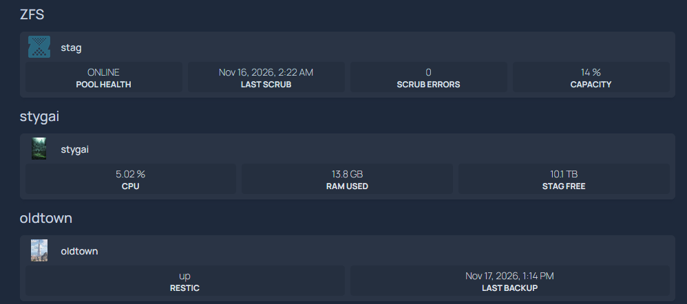

# stygai-status

[](https://github.com/awaleha/stygai-status/actions/workflows/ci.yml)

Status API for my Homepage dashboard. One Go service that answers the questions I care about on my homelab box: containers up? hardware ok? when did the last ZFS scrub run? when did oldtown's backups land? Failures reach my phone through Healthchecks → ntfy.

Written as a Go learning project — stdlib-first, gopsutil the one heavyweight dependency.

stygai   == my home server

oldtown  == my home pc

## Architecture

```text
                        Tailscale (tailnet)
    oldtown (restic wrapper) ────────────┐
    phone (ntfy app) ────────────────────┤
                                         ▼
               traefik                    (tailnet only)
                    │           │
               /hc  │           │  /ntfy
                    ▼           ▼
             healthchecks ──alert──► ntfy ◄── notify CLI (from scripts)
                    ▲
      ping /start /exit (curl) from cron scripts
                    │
   homepage ◄──customapi── stygai-status (internal network only)
                 ├── zpool list / zpool status ──► pool stag (last/next scrub)
                 ├── gopsutil ───────────────────► cpu, ram, disks, load
                 ├── docker socket API ──────────► containers
                 └── healthchecks API (read key) ─► last oldtown restic backup
```

## Endpoints

| Endpoint | What |
|---|---|
| `GET /healthz` | liveness |
| `GET /api/v1/zfs` | pool `stag`: health, size, last/next scrub |
| `GET /api/v1/system` | cpu, memory, disks, load, uptime |
| `GET /api/v1/docker` | containers with health state |
| `GET /api/v1/backups` | last run of the `oldtown-restic` Healthchecks check |

## Quickstart

Server needs `HC_URL` and `HC_KEY` (Healthchecks API). `notify` needs `NTFY_URL`, plus `NTFY_TOKEN` if the topic requires auth. See `.env.example`.

```sh
go run ./cmd/stygai-status            # API on :8082
go run ./cmd/notify --topic alerts "backup done"
```

Docker compose:

```yaml
services:
  stygai-status:
    build: .
    env_file: .env
    environment:
      - HOST_PROC=/host/proc
      - HOST_SYS=/host/sys
    volumes:
      - /proc:/host/proc:ro
      - /sys:/host/sys:ro
      - /mnt/stag:/mnt/stag:ro
      - /var/run/docker.sock:/var/run/docker.sock:ro
      - /run/dbus/system_bus_socket:/run/dbus/system_bus_socket:ro
    devices:
      - /dev/zfs:/dev/zfs
    group_add:
      - "994"                          # docker socket group on the host
    healthcheck:
      test: ["CMD", "/usr/local/bin/stygai-status", "healthcheck"]
      interval: 30s
      timeout: 5s
      retries: 3
```

It joins the homepage network; the API publishes no host ports. `make build` and `make test` cover the rest.

## Screenshots



## Security notes

- Tailnet-only. The API publishes no host ports — it lives on the internal docker network; Homepage fetches it server-side.
- No auth on the API itself. Access control is the tailnet plus the internal network.
- Docker socket mounted read-only; Healthchecks uses a read-only API key.
